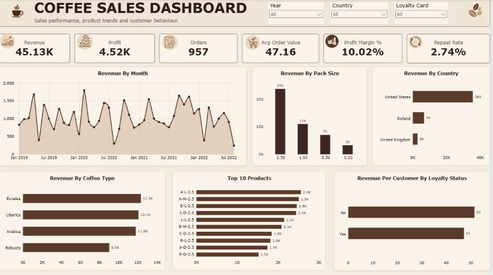

# Coffee-Sales-Analytics

## Project Overview

An interactive Power BI dashboard that analyses coffee orders across three countries. The project covers the full analytics workflow: data audit, cleaning in Power Query, data modelling, DAX measures, dashboard design and validation.

## Business problem

A coffee retailer wants to understand which products, markets and customers drive sales, and whether customers come back. This project answers those questions with a single-page dashboard that a sales or commercial manager can use to see overall performance, compare products and markets, and spot where to look further.

## Business questions

1. How are revenue, profit and orders performing overall?
2. How does revenue change over time?
3. Which coffee types, pack sizes and products contribute most revenue?
4. Which countries generate the most revenue?
5. How many customers order more than once?
6. Do loyalty-card holders spend differently from other customers?

## Dataset

| Table | Rows | What one row represents |
|---|---|---|
| `orders` | 1,000 | One product line within an order (957 distinct orders) |
| `customers` | 1,000 | One customer (913 placed at least one order) |
| `products` | 48 | One product variant (4 coffee types x 3 roasts x 4 pack sizes) |

- Order dates run from 2 January 2019 to 19 August 2022 (2022 is a partial year).
- Customers are located in the United States, Ireland and the United Kingdom.

## Tools

Power BI Desktop, Power Query, DAX, Microsoft Excel

## Data cleaning (Power Query)

- Profiled every column before changing anything (row counts, distinct counts, blanks, errors).
- Set correct data types, and kept ID columns and postcodes as text.
- Removed unused empty columns from `orders`.
- Trimmed and cleaned ID columns so relationships match reliably.
- Removed personal data columns (customer name, email, phone number, street address) because the analysis does not need them.
- Added readable names for coffee type.

## Data model

`orders` is the fact table. It connects to `customers` and `products` through Customer ID and Product ID (many-to-one, single direction), and to a `DateTable` through Order Date. The date table is marked as a date table and runs from 1 January 2019 to the last order date.

## Key measures (DAX)

| Measure | Definition |
|---|---|
| Revenue | Quantity x Unit Price, summed row by row (`SUMX` with `RELATED`) |
| Profit | Quantity x Profit per unit, summed row by row |
| Orders | Distinct count of Order ID |
| Avg Order Value | Revenue divided by Orders |
| Profit Margin % | Profit divided by Revenue |
| Customers | Distinct count of Customer ID among customers who ordered |
| Repeat Customers | Customers with more than one distinct order |
| Repeat Rate | Repeat Customers divided by Customers |
| Revenue per Customer | Revenue divided by Customers |

## Validation

- Row counts after cleaning matched the source (1,000 / 1,000 / 48).
- Total Quantity in Power BI matched the Excel total.
- Revenue and Profit were reconciled against an independent calculation in Excel: Revenue 45,134.30 and Profit 4,520.22, with no difference.
- Totals by country and by coffee type add up to the overall total.

## Key insights

**1. Revenue is concentrated in the United States.**
The US accounts for roughly 36K of 45.13K total revenue (about 80%), with Ireland near 7K and the UK near 3K. The US also holds 782 of the 1,000 customers, so this may reflect the size of the customer base rather than higher spending per customer. Revenue per customer by country would test that.

**2. The largest pack size brings in about half of revenue.**
The 2.5 pack size generates around 24K, roughly 53% of total revenue, and all ten of the top products are 2.5 packs. Larger packs have higher prices, so revenue share does not show how many units were sold or how much profit they earn.

**3. Coffee types are close, except Robusta.**
Excelsa (12.3K), Liberica (12.1K) and Arabica (11.8K) are within about 0.5K of each other. Robusta is lowest at 9.0K. In the product table, profit is a fixed share of unit price within each coffee type (Arabica 9%, Excelsa 11%, Liberica 13%, Robusta 6%), so ranking by profit differs from ranking by revenue.

**4. Few customers order more than once.**
Only 25 of 913 customers (2.74%) placed more than one order, and about 97% of orders contain a single product line. This points to repeat purchasing and basket size as areas worth investigating, though the data covers orders only and cannot explain why customers do not return.

**5. Loyalty-card holders do not show higher revenue per customer.**
Average revenue per customer is about 52 for customers without a card and about 47 for those with one. The difference is small, and the data does not show when each customer got the card, so it cannot show whether the card works.

## Repository structure
- [Dataset](Coffee-Order-Dataset.xlsx)
- [PowerBI Report File](Coffee-Orders.pbix)
- [Dashboard Screenshot](Coffee-order.png)
- README.md

